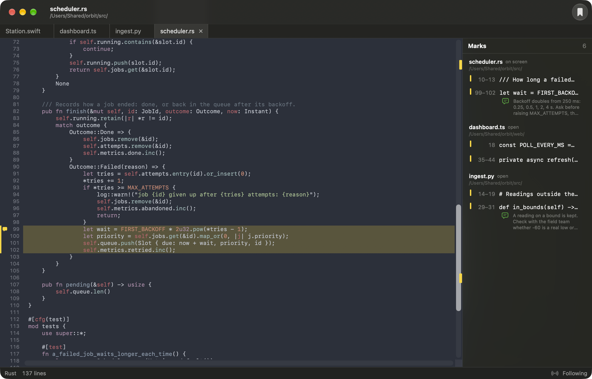
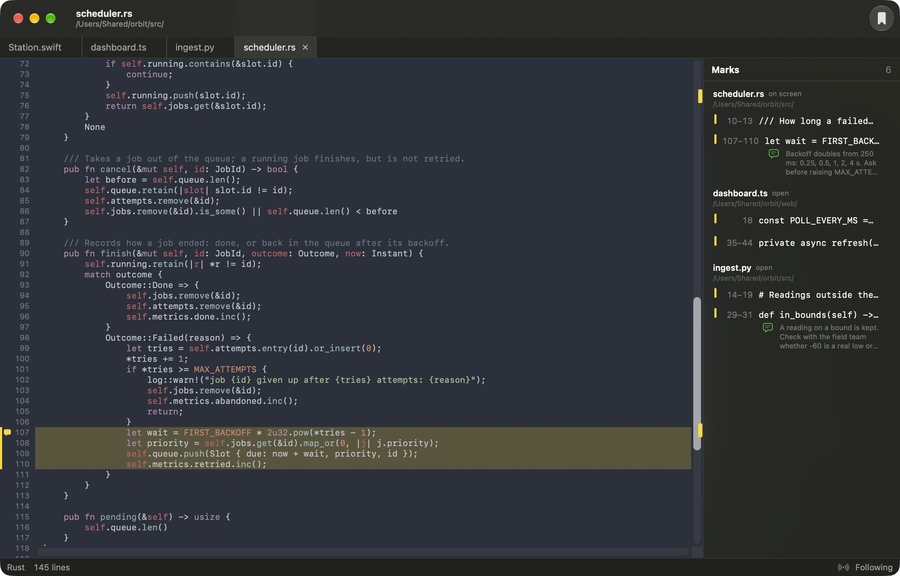
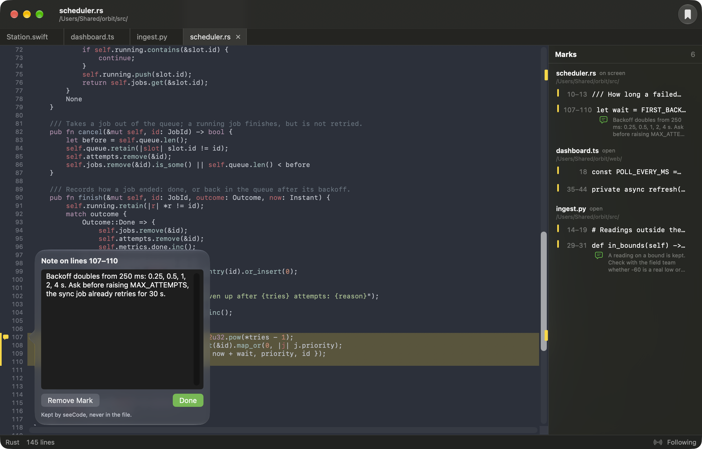
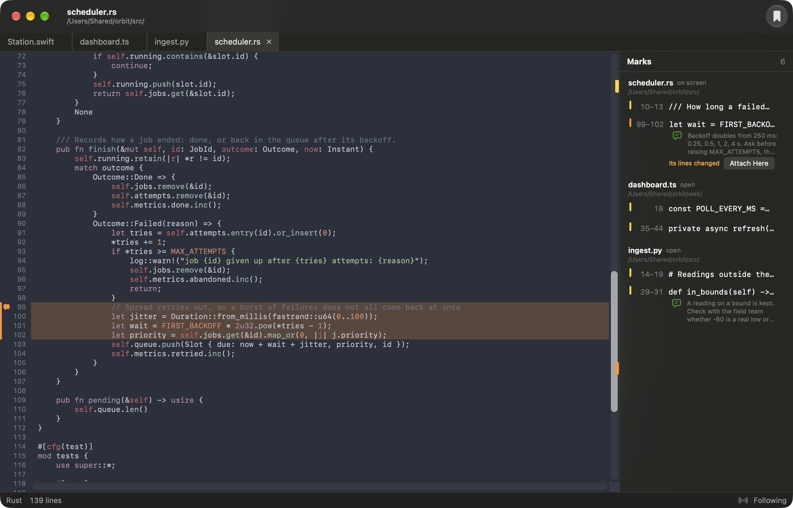
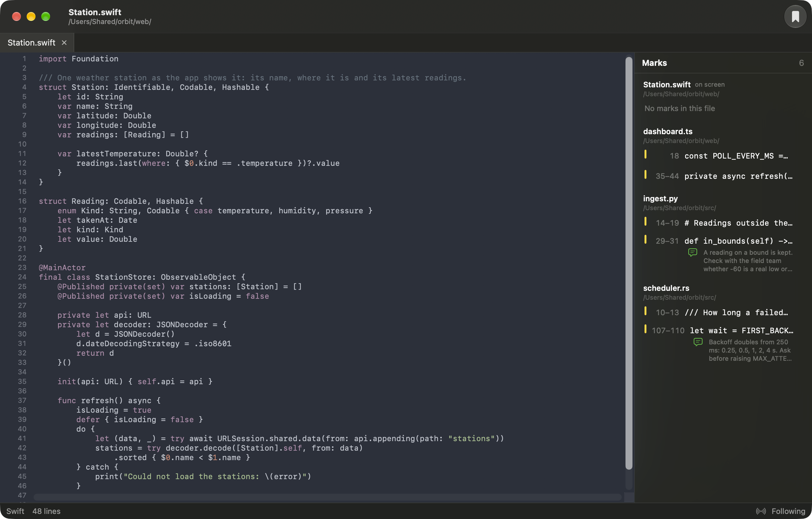
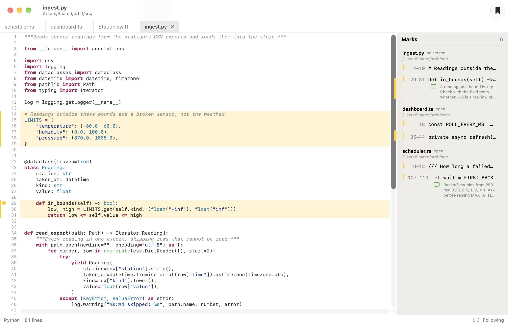

# seeCode

***Look, don't touch.*** A viewer for code and text files, by [RawData Studio](https://rawdatastudio.com).

seeCode shows a file in its syntax and keeps showing it as it changes, while your IDE or an agent works on it somewhere else. It is a viewer, not an editor: it cannot change the file you are looking at. Mark the lines that matter and write notes on them; they stay with seeCode, follow their lines as the file changes, and never go into your file. For the Mac first, then Windows, then Linux.

**In development** · No release date yet

> This repository is seeCode's public home: screenshots, progress, and a place for your questions and ideas. The app's source code is private while we build it.

*A Rust file in four open tabs, two marked blocks, a note, and the Marks panel with every mark in three files.*

## The Idea
- **A viewer, never an editor**: every programming language shown in its syntax, with no way to change the file
- **Never disturbs the file**: watch a file while it is being edited elsewhere, and it carries on as if you were not there
- **A peek at live work**: see what your IDE and your agent are doing to a file as they do it
- **Notes and marks**: write on top of what you see; your notes stay with seeCode and follow the file as it changes
- **Workspaces**: open a whole project, as you would in VS Code
- **Open in your IDE**: one step from looking to editing, in the IDE you already have
- **Know the file**: whether it is open somewhere else, and its history on your system

## What's Built So Far
In the build so far, on the Mac:
- **Open a file** and see it in its colours, in 220 languages, with line numbers, in light or dark
- **Watch it change**: edits made in your editor or by an agent appear as they are saved, and the screen stays on the lines you were reading; a bar beside the line numbers shows what the last save changed
- **Choose how live each tab is**: Hold keeps your place; Follow goes to each change once the agent stops writing and lights it; Pause freezes the view and counts the changes waiting, landing them all when you resume
- **Open many files in tabs**: a tab shows a dot when its file changed while you were looking at another
- **Select and copy** the text; there is no way to type into it
- **Open large files**: a 100,000-line file opens at once
- **Mark lines**: click or drag down their numbers. A mark stays with its lines as the file changes around it; if some of its lines change, it stays with the rest, turns orange and says so, and you can attach it where it belongs
- **Keep marks whose lines were deleted**: they are set aside, with a marker where they were and a Set Aside list in the Marks panel; each comes back by itself when its lines return, or you put it on the lines you choose
- **Write notes on your marks** in a popover beside the line; a note icon shows beside the line number
- **Find your marks** in the Marks panel, with Next and Previous Mark and a tick in the scroller where each one is
- **Reach every marked file** from the Marks panel, open or not: a click opens the file at the mark
- **Your files stay yours**: marks and notes are kept by seeCode in a store of its own, never in your file, and seeCode has no way to write to a file it shows

## From the Build

  
  

  
  

*A function added from outside the app, and the marks moving down with their lines; a note on a mark; a marked block changed, flagged orange; and every marked file in the panel, open or not. November 2026, work in progress.*

*In light mode: Python with two marks and a note.*

## Roadmap
| Phase | Status |
| --- | --- |
| Foundations | In progress · November 2026: a Rust core under a native Mac app; files shown in their colours and followed live; tabs and line numbers; marks and notes that follow their lines, every marked file in one panel; marks whose lines were deleted, kept aside to put back; Hold, Follow and Pause, how live each tab is. Next: workspaces |
| Workspaces, Open in your IDE, knowing the file | Planned |
| Windows and Linux | Planned |

## Get Involved
- **Questions, ideas, or just want to say hi?** Start a thread in [Discussions](../../discussions).
- **Feedback on something you've seen?** Open an [issue](../../issues/new/choose).
- **Follow along** at [rawdatastudio.com](https://rawdatastudio.com).
